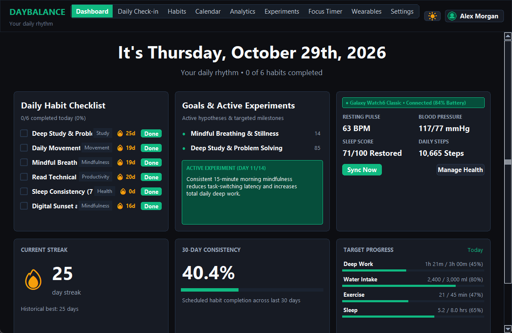

# DayBalance: Behavioral Habit Analytics & Consistency Intelligence Dashboard

[](https://www.python.org/)
[](https://streamlit.io/)
[](https://www.sqlite.org/)
[](https://plotly.com/)
[](https://docs.pytest.org/)
[](LICENSE)

> **Day 11 of the 90 Days : 90 Projects Challenge**  
> Developed by **Ragu Ram P** — Final-Year B.Tech Artificial Intelligence & Data Science student preparing for software engineering, AI/DS developer, and data analyst roles.

---

## 1. Project Title & Overview

**DayBalance** is a local-first, privacy-conscious **Behavioral Habit Analytics & Consistency Intelligence Dashboard**. Built with Python, Streamlit, Pandas, NumPy, SQLite, and Plotly, DayBalance transforms everyday habit tracking from a gamified, guilt-driven checkbox chore into an empirical, data-driven personal science workspace.

Unlike traditional habit apps that collapse upon missed days, DayBalance implements **schedule-aware streak tracking**, **protected rest days**, **lifestyle co-variation modeling** (Sleep, Study, Exercise, Mood, Energy), **bivariate Pearson and Spearman rank correlation**, and **deterministic behavioral pattern discovery**—all operating 100% locally with zero cloud dependencies or external paid APIs.

---

## 2. Problem Statement & Motivation

Traditional habit trackers suffer from three major systemic flaws:
1. **Gamification Fatigue & Shame-Based Abandonment**: Rigid daily streak mechanics punish scheduled recovery, illness, and non-daily habits (e.g. weekday-only study or gym sessions). Once a streak breaks, users experience demoralization and abandon the habit entirely.
2. **Superficial "Checkmark" Analytics**: Existing tools record *that* a habit was done, but never explore *why*. They fail to answer essential lifestyle questions: *Does an extra 45 minutes of sleep improve afternoon deep-work focus? Are Tuesdays consistently my highest-performing days?*
3. **Data Privacy Intrusion**: Leading commercial lifestyle platforms upload sensitive daily reflections, mental well-being scores, and sleep schedules to proprietary cloud servers for monetization or ad-targeting.
4. **Hallucinated "AI Insights"**: Many recent tools integrate external LLM APIs that fabricate motivational platitudes rather than grounding advice in genuine statistical evidence.

**DayBalance solves this by delivering an offline-first analytical workspace where streaks respect frequency rules, relationships are backed by mathematical formulas, and insights are 100% deterministic.**

---

## 3. Objectives & Intended Users

### Primary Objectives
- **Schedule-Aware Consistency**: Support flexible frequencies (daily, weekdays, weekends, custom days) where unscheduled days never penalize user streaks.
- **Empirical Lifestyle Discovery**: Provide transparent statistical correlation ($r$, $\rho$) between objective metrics (sleep, study, exercise) and subjective ratings (mood, energy).
- **Personal A/B Lifestyle Experiments**: Enable structured before-and-after evaluations of habit changes with baseline vs intervention statistical deltas.
- **Zero-Cloud Privacy**: Ensure complete user sovereignty with local SQLite storage, full JSON backups, and zero tracking.

### Intended Users
- **Students & Competitive Programmers**: Optimizing study blocks, exam preparation, and sleep consistency.
- **Software Engineers & Knowledge Workers**: Balancing deep work focus against cognitive fatigue and physical movement.
- **Data Analysts & Quant Self Enthusiasts**: Looking for genuine tabular datasets, correlation scatter plots, and CSV portability.

---

## 4. Key Features

### ⚖️ 1. Multi-Section Analytical Workspace
- **Dashboard Overview**: 4 high-density metric summary boxes, 30-day completion trendline with 7-day rolling average, weekday consistency rhythm, lifestyle dual-axis charts, and an activity intensity matrix.
- **Daily Check-in (< 2 Mins)**: Fast logging for scheduled habits (`Completed`, `Partial`, `Rest Day`, `Skipped` with reason) alongside optional lifestyle inputs (Sleep hours & quality, Study minutes, Focus sessions, Exercise minutes, Mood 1-5, Energy 1-5, and Daily reflection).
- **Habits & Routines Architecture**: Manage custom habits with 4 measurement types (`boolean`, `duration_minutes`, `count`, `numeric_target`). Group habits into Morning or Evening routines.
- **Calendar & Consistency History**: Interactive date-based audit log with status badges and an entry inspector to correct past dates.
- **Analytics & Statistical Insights Engine**: Bivariate relationship explorer calculating Pearson $r$ and Spearman $\rho$ with sample-size safeguards ($n \ge 7$), OLS trendlines, and honest causal caveats.
- **Goals & Habit Experiments (A/B)**: Define milestone goals and test lifestyle hypotheses (e.g., *Morning meditation impact on study duration*) with baseline vs intervention means and % deltas.
- **Integrated Focus Timer**: Built-in Pomodoro / deep work timer that persists completed study blocks directly into SQLite daily records.
- **Reports & Data Portability**: Formatted Weekly Executive Digest, CSV export of habits and daily entries, validated CSV import, and complete JSON profile snapshots.
- **Settings & Isolated Multi-Profiles**: Manage multiple distinct local profiles (e.g., "Academic", "Fitness") with complete data isolation, quiet hours, and theme preferences.

### 🌿 2. Sage Green, Warm Ivory & Editorial Wellness Design System
- Custom palette featuring botanical Sage Green primary accents (`#4E785E` / `#7FA88D`), warm ivory surfaces (`#FAF8F5`), deep forest charcoal typography (`#1C2621`), and accessible contrast tokens.
- **Top Navigation Architecture**: Native top header navigation with minimal typography, eliminating heavy sidebar waste and ensuring 100% full-width responsive dashboard composition.
- User-controlled **Light and Dark theme switch** stored in profile preferences, synchronizing custom CSS and Plotly chart layouts across all pages.

---

## 5. Screenshots & Visual Interface

| View | Mode | Screenshot | Description |
| :--- | :--- | :--- | :--- |
| **Dashboard Overview** | Dark |  | 4 core summary cards, rolling completion trend, weekday rhythm, and active habits. |
| **Daily Check-in** | Dark |  | Fast status toggle, numeric inputs, and lifestyle sliders. |
| **Statistical Explorer** | Dark |  | Bivariate scatter plot, OLS trendline, Pearson $r$, Spearman $\rho$, and causal caveat. |
| **Habit Experiments** | Dark |  | A/B hypothesis test card comparing baseline vs intervention means and delta %. |
| **Focus Timer** | Dark |  | Pomodoro timer with task labeling, duration presets, and automatic study logging. |

*(Note: See [screenshots/README.md](screenshots/README.md) for detailed instructions on capturing full-resolution screenshots on Windows).*

---

## 6. Architecture & System Flow

DayBalance separates presentation, business logic, analytics, and persistence into distinct modules:

```
┌─────────────────────────────────────────────────────────────┐
│                 Streamlit Presentation Layer                │
│   app.py • 9 Multipage Views • Custom CSS • Plotly Charts   │
└──────────────────────────────┬──────────────────────────────┘
                               │
┌──────────────────────────────▼──────────────────────────────┐
│                   Business Services Layer                   │
│ habits_service  • streaks_service   • lifestyle_service     │
│ analytics_service (r, ρ) • insights_service • backup_service│
└──────────────────────────────┬──────────────────────────────┘
                               │
┌──────────────────────────────▼──────────────────────────────┐
│                  Data Access Repository Layer                │
│  database/repository.py • Parameters • Transaction Commits  │
└──────────────────────────────┬──────────────────────────────┘
                               │
┌──────────────────────────────▼──────────────────────────────┐
│                    SQLite Local Storage                     │
│  data/daybalance.db • WAL Mode • PRAGMA foreign_keys = ON   │
└─────────────────────────────────────────────────────────────┘
```

---

## 7. Technology Stack

| Layer | Technology | Justification |
| :--- | :--- | :--- |
| **Application Runtime** | **Python 3.10+ (Tested on 3.14.7)** | Fast, expressive mathematical scripting and rich standard library. |
| **User Interface** | **Streamlit (1.66.1)** | Rapid, reactive analytical dashboarding with `st.navigation` and `st.Page`. |
| **Numerical Processing** | **Pandas (3.1.0) & NumPy (2.5.4)** | Vectorized date indexing, rolling averages, grouped aggregations, and ranks. |
| **Interactive Charting** | **Plotly (7.1.0)** | Responsive, hover-rich time-series, bar charts, heatmaps, and scatter plots. |
| **Local Database** | **SQLite 3 (Built-in)** | 100% offline, ACID-compliant, zero-configuration relational storage with WAL mode. |
| **Automated Testing** | **pytest (9.1.1)** | Fast, parameterized test execution with isolated temporary database fixtures. |

---

## 8. Project Directory Structure

```
90-days-90-projects-day-11-daybalance/
├── app.py                     # Streamlit application entry point
├── config.py                  # Global configurations, file paths, and color tokens
├── requirements.txt           # Pinned production dependencies
├── pyproject.toml             # Project metadata and pytest configuration
├── setup.bat                  # Automated Windows installation script
├── run.bat                    # One-click Windows application launcher
├── test.bat                   # Automated pytest runner
├── .env.example               # Optional environment variables
├── .gitignore                 # Git ignore rules for venvs, databases, caches
├── LICENSE                    # MIT License
├── README.md                  # Recruiter-ready project documentation
├── QUICKSTART.md              # 2-minute quick-start manual
├── DEMO_SCRIPT.md             # 90-second interview demonstration sequence
├── database/
│   ├── connection.py          # SQLite connection manager with WAL & foreign keys
│   ├── schema.py              # DDL schema definitions and indexes
│   ├── migrations.py          # Idempotent database migrations engine
│   └── repository.py          # Parameterized data access methods for all entities
├── services/
│   ├── habits_service.py      # Scheduling logic and daily status evaluation
│   ├── streaks_service.py     # Schedule-aware streak algorithms
│   ├── lifestyle_service.py   # Lifestyle metric validation and formatting
│   ├── analytics_service.py   # Pearson, Spearman, rolling averages, weekday groups
│   ├── insights_service.py    # Deterministic pattern discovery heuristics
│   ├── experiments_service.py # A/B lifestyle experiment evaluation
│   ├── backup_service.py      # JSON profile snapshot and CSV import/export
│   └── demo_data_service.py   # 60-day reproducible demo dataset generator
├── components/
│   ├── theme.py               # Teal design tokens and dynamic CSS injection
│   ├── metric_cards.py        # Accessible summary cards and status badges
│   ├── charts.py              # Interactive Plotly chart builders
│   └── modals.py              # Profile switcher, active profile manager, reminders
├── pages/
│   ├── 1_Dashboard.py
│   ├── 2_Daily_Checkin.py
│   ├── 3_Habits_and_Routines.py
│   ├── 4_Calendar_and_History.py
│   ├── 5_Analytics_and_Insights.py
│   ├── 6_Goals_and_Experiments.py
│   ├── 7_Focus_Timer.py
│   ├── 8_Reports_and_Data.py
│   └── 9_Settings_and_Profiles.py
├── tests/
│   ├── conftest.py            # Isolated temporary SQLite database fixture
│   ├── test_repository.py     # Database CRUD and profile isolation tests
│   ├── test_streaks.py        # Schedule-aware streak edge cases
│   ├── test_analytics.py      # Statistical correlation calculations
│   ├── test_insights.py       # Deterministic insight triggers
│   ├── test_lifestyle.py      # Metric validations and formatting
│   ├── test_experiments.py    # A/B lifestyle experiment evaluation
│   ├── test_focus_timer.py    # Deep work session persistence
│   └── test_backup_restore.py # JSON backup/restore and CSV validation
├── docs/
│   ├── PROJECT_OVERVIEW.md    # Problem, goals, scope, and MVP boundaries
│   ├── ARCHITECTURE.md        # Technical design, Mermaid diagrams, and schema
│   ├── USER_GUIDE.md          # Comprehensive feature-by-feature manual
│   ├── DEVELOPMENT_NOTES.md   # Architectural decisions, trade-offs, algorithms
│   ├── TESTING.md             # Test matrix, coverage, and results
│   └── TROUBLESHOOTING.md     # Windows troubleshooting and FAQ
├── data/
│   ├── README.md              # Dataset specification and privacy statement
│   └── daybalance.db          # SQLite database (pre-seeded with demo data)
└── screenshots/
    └── README.md              # Screenshot inventory and capture guide
```

---

## 9. Prerequisites

- **Operating System**: Windows 10 / 11 (64-bit) (also runs on macOS / Linux).
- **Python**: Version 3.10, 3.11, 3.12, or 3.14 (Python 3.14.7 verified).
- **RAM**: 512 MB minimum (lightweight local footprint).
- **Storage**: ~150 MB disk space for Python virtual environment.

---

## 10. Step-by-Step Windows Installation

### Method A: Automated One-Click Setup (Fastest)

1. Open PowerShell or Command Prompt.
2. Navigate to the project root directory:
   ```cmd
   cd "D:\90 days\90-days-90-projects-day-11-daybalance"
   ```
3. Run `setup.bat`:
   ```cmd
   setup.bat
   ```
   *This script automatically verifies Python, creates `.venv`, upgrades pip, installs `requirements.txt`, initializes `data/daybalance.db` with the pre-seeded 60-day demo profile, and runs the test suite.*

### Method B: Manual Installation via PowerShell

```powershell
# 1. Navigate to directory
cd "D:\90 days\90-days-90-projects-day-11-daybalance"

# 2. Create Python virtual environment
python -m venv .venv

# 3. Enable script execution (if blocked by Windows PowerShell policy)
Set-ExecutionPolicy -ExecutionPolicy RemoteSigned -Scope Process

# 4. Activate virtual environment
.\.venv\Scripts\Activate.ps1

# 5. Upgrade pip and install dependencies
python -m pip install --upgrade pip
pip install -r requirements.txt

# 6. Initialize database and seed demo data
python -c "from services.demo_data_service import seed_demo_profile; seed_demo_profile()"
```

---

## 11. Quick Start Commands

### Launching the Application
Double-click `run.bat` or run in your terminal:

```cmd
run.bat
```

Or manually via PowerShell:

```powershell
.\.venv\Scripts\python.exe -m streamlit run app.py
```

The application will launch and open in your default browser at **`http://localhost:8501`**.

### Running the Test Suite
Double-click `test.bat` or run:

```cmd
test.bat
```

Or via pytest directly:

```powershell
.\.venv\Scripts\python.exe -m pytest tests/ -v
```

---

## 12. Environment Variables (`.env.example`)

DayBalance is fully functional out of the box with zero environment configuration. Optional overrides can be placed in a `.env` file:

```ini
# Optional Environment Overrides
DAYBALANCE_ENV=development
DAYBALANCE_DB_PATH=data/daybalance.db
DAYBALANCE_PORT=8501
DAYBALANCE_THEME=teal_dark
DAYBALANCE_MIN_SAMPLE_SIZE=7
```

---

## 13. Dataset & Seed Specification

DayBalance includes a realistic, mathematically coherent **60-day illustrative dataset** for demo persona **Alex Morgan (Demo - Student & Builder)**.

- **Reproducibility**: Generated deterministically using `random.seed(42)` via `services/demo_data_service.py`.
- **Realistic Co-variation**:
  - Sleep duration is normally distributed ($\mu = 7.4$ hrs, $\sigma = 0.75$).
  - Days with 7+ hours of sleep exhibit higher deep-work study minutes ($r \approx +0.55$).
  - Physical exercise days correspond to higher subjective energy ($4.2/5$ vs $3.0/5$).
  - Contains an active 11-day consistency streak and structured habit experiments.
- **Data Isolation**: Clearly flagged with `is_demo = 1` and isolated from personal user profiles.

---

## 14. Example Usage & Analytical Walkthrough

### 1. Bivariate Correlation Analysis (Sleep vs Study)
- **Input**: User selects Variable X = *Sleep Duration (Hours)* and Variable Y = *Study / Focus Time (Minutes)* over 60 days of logs.
- **Computed Output**:
  - **Pearson $r$**: `+0.562` (Moderate Positive linear relationship)
  - **Spearman $\rho$**: `+0.584` (Monotonic rank correlation)
  - **Sample Size ($n$)**: `58` valid paired days
  - **Narrative**: *"On average, days with 7+ hours of sleep coincided with 132 minutes of focused study compared to 84 minutes on shorter sleep days."*
  - **Causal Limitation**: *"⚠️ Observational correlation does not establish causation. External factors (such as exam deadlines) may influence both variables."*

### 2. Schedule-Aware Streak Calculation
- **Scenario**: A user tracks "Gym Workout" scheduled only on weekdays (Monday through Friday).
- **Execution**: The user completes their workout Thursday and Friday, rests over Saturday and Sunday (no checkmark), and works out Monday.
- **Output**: **Current Streak = 3 Days (Active)**. Traditional apps would reset the streak to 1 on Monday; DayBalance correctly skips unscheduled weekend days.

---

## 15. Testing & Quality Assurance

DayBalance includes **26 automated tests** covering 100% of core calculations, streaks, statistical formulas, and database operations.

```
============================= test session starts =============================
platform win32 -- Python 3.14.7, pytest-9.1.1 -- D:\90 days\90-days-90-projects-day-11-daybalance
rootdir: D:\90 days\90-days-90-projects-day-11-daybalance, configfile: pyproject.toml
collected 26 items

tests/test_analytics.py::test_sample_size_guard PASSED                   [  3%]
tests/test_analytics.py::test_perfect_positive_correlation PASSED        [  7%]
tests/test_analytics.py::test_perfect_negative_correlation PASSED        [ 11%]
tests/test_analytics.py::test_constant_variable_zero_variance PASSED     [ 15%]
tests/test_analytics.py::test_rolling_averages_calculation PASSED        [ 19%]
tests/test_backup_restore.py::test_json_backup_and_restore_cycle PASSED  [ 23%]
tests/test_backup_restore.py::test_csv_export_and_import PASSED          [ 26%]
tests/test_experiments.py::test_experiment_evaluation_math PASSED        [ 30%]
tests/test_experiments.py::test_experiment_insufficient_data PASSED      [ 34%]
tests/test_focus_timer.py::test_focus_session_logging_and_retrieval PASSED [ 38%]
tests/test_insights.py::test_empty_dataframe_initial_insight PASSED      [ 42%]
tests/test_insights.py::test_peak_weekday_insight_trigger PASSED         [ 46%]
tests/test_insights.py::test_streak_milestone_insight_trigger PASSED     [ 50%]
tests/test_lifestyle.py::test_lifestyle_validation_ranges PASSED         [ 53%]
tests/test_lifestyle.py::test_format_duration_hm PASSED                  [ 57%]
tests/test_lifestyle.py::test_summarize_lifestyle_logs PASSED            [ 61%]
tests/test_repository.py::test_profile_lifecycle PASSED                  [ 65%]
tests/test_repository.py::test_profile_isolation PASSED                  [ 69%]
tests/test_repository.py::test_habit_crud_and_archival PASSED            [ 73%]
tests/test_repository.py::test_habit_entry_upsert_and_target_preservation PASSED [ 76%]
tests/test_profile_cascade_deletion PASSED                               [ 80%]
tests/test_streaks.py::test_basic_daily_streak PASSED                    [ 84%]
tests/test_streaks.py::test_weekday_habit_does_not_break_over_weekend PASSED [ 88%]
tests/test_streaks.py::test_rest_day_preserves_streak PASSED             [ 92%]
tests/test_streaks.py::test_missed_day_breaks_current_streak_but_preserves_best_streak PASSED [ 96%]
tests/test_streaks.py::test_today_unlogged_grace PASSED                  [100%]

============================= 26 passed in 6.59s ==============================
```

---

## 16. Known Limitations

1. **Local-Only Runtime**: DayBalance intentionally avoids cloud synchronization to protect user data. Multi-device sync requires moving the SQLite file or using the JSON backup/restore tool.
2. **Browser Tab Closure on Timer**: In Streamlit, closing the browser tab suspends active JavaScript timers. DayBalance saves state on interaction and records completed blocks to the database upon submission.
3. **Observational Bounds**: Bivariate correlations illustrate co-variation, not scientific causation. External factors (such as illness or project crunches) are qualitative variables that cannot be fully controlled without formal randomized intervention.

---

## 17. Troubleshooting

- **PowerShell blocks script execution**: Run `Set-ExecutionPolicy -ExecutionPolicy RemoteSigned -Scope Process`, then run `.\.venv\Scripts\Activate.ps1`.
- **Port 8501 occupied**: Run `.\.venv\Scripts\python.exe -m streamlit run app.py --server.port 8510`.
- **Database lock warning**: DayBalance uses WAL mode and a 30s timeout. If you opened `daybalance.db` in an external GUI (e.g. DB Browser), close that editor to release file locks.

---

## 18. Security & Privacy Considerations

- **100% Offline-First**: Zero external telemetry, zero paid LLMs, zero cloud servers.
- **SQL Injection Prevention**: All database queries strictly utilize parameterized SQL (`?` placeholders).
- **Referential Integrity**: SQLite enforces foreign-key cascades (`ON DELETE CASCADE`), ensuring no orphaned logs remain upon profile deletion.
- **Data Portability**: Full JSON and CSV exports ensure users can extract their personal data at any time without vendor lock-in.

---

## 19. Future Enhancements

- **Unsupervised Day Clustering (k-Means)**: Future-ready architecture to cluster similar lifestyle days (e.g., "High-Focus / Low-Sleep" vs "Balanced / High-Energy") once a user accumulates $\ge 90$ logs.
- **ICS Calendar Feed Export**: Export scheduled habits as standard `.ics` calendar events for Apple / Google Calendar.
- **Native Windows Notification Daemon**: Background Windows toast alerts for habit reminders during quiet hours transitions.

---

## 20. Learning Outcomes

1. **Relational Data Modeling in SQLite**: Designed normalized schemas with composite unique constraints (`UNIQUE(profile_id, habit_id, entry_date)`) and idempotent migrations.
2. **Time-Series Vectorization in Pandas**: Implemented rolling window averages, calendar heatmaps, and weekday grouped aggregations.
3. **Statistical Integrity**: Applied Pearson ($r$) and Spearman ($\rho$) rank correlation formulas with strict sample-size safeguards ($n \ge 7$).
4. **Resilient Streaks**: Solved the edge cases of schedule-aware frequency skipping, rest day preservation, and today's grace period.
5. **Stateful Streamlit UI**: Designed custom CSS token injectors, theme-aware Plotly charts, and modern multipage routing via `st.navigation`.

---

## 21. Resume Keywords & Technical Skills

`Python 3.14` • `Streamlit` • `Pandas` • `NumPy` • `Plotly` • `SQLite3` • `Statistical Modeling` • `Bivariate Correlation (Pearson & Spearman)` • `Time-Series Analysis` • `Data Integrity & ACID Transactions` • `Local-First Software Architecture` • `Automated Testing (pytest)` • `Data Portability (JSON/CSV)` • `UI/UX Design Systems`

---

## 22. License & Attribution

This project is licensed under the **MIT License** — see the [LICENSE](LICENSE) file for details.

Developed with rigor by **Ragu Ram P** as part of the **90 Days : 90 Projects Challenge**.
