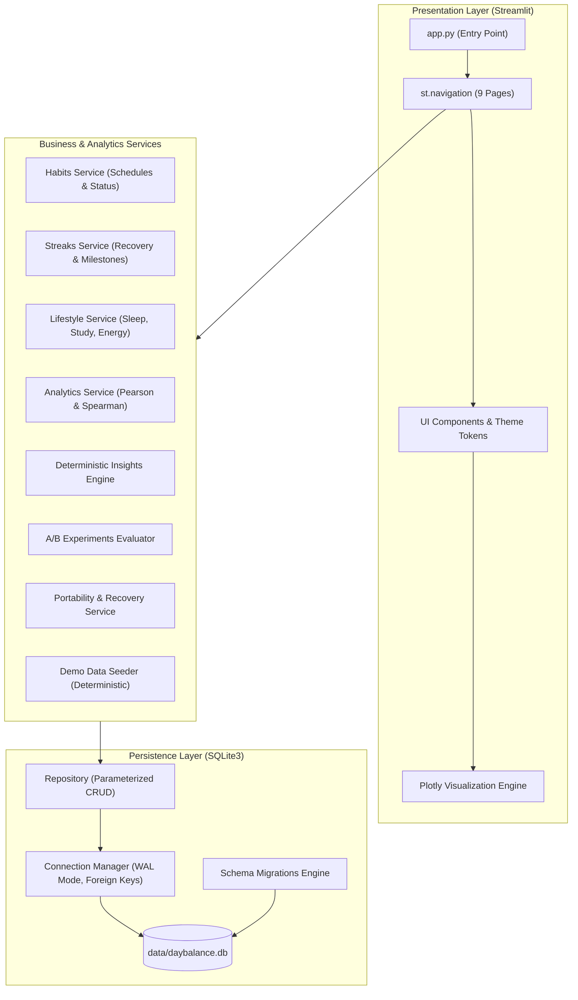
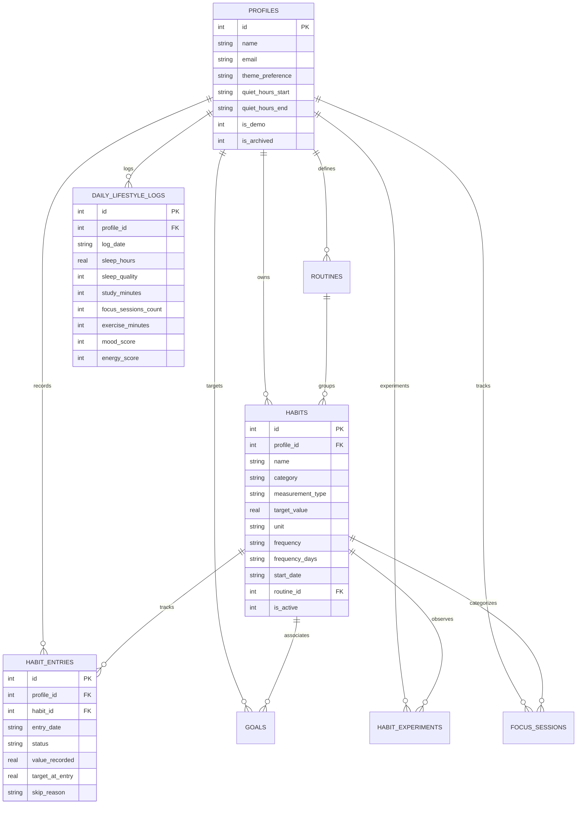

# DayBalance: Architecture & System Design

This document details the modular software architecture, data flow, statistical modeling pipeline, and database schema of **DayBalance**.

---

## 1. Architectural Diagram



---

## 2. Directory Structure & Modular Separation

```
90-days-90-projects-day-11-daybalance/
├── app.py                     # Main Streamlit execution entry point
├── config.py                  # Global constants, paths, and visual theme tokens
├── requirements.txt           # Pinned production dependencies
├── pyproject.toml             # Project metadata and pytest configuration
├── setup.bat                  # One-click Windows setup script
├── run.bat                    # One-click Windows application launcher
├── test.bat                   # Automated pytest runner
├── database/
│   ├── connection.py          # SQLite connection manager with WAL and foreign keys
│   ├── schema.py              # DDL schema definitions and performance indexes
│   ├── migrations.py          # Idempotent database initialization and versioning
│   └── repository.py          # Parameterized data access methods for all entities
├── services/
│   ├── habits_service.py      # Habit scheduling and daily status evaluation
│   ├── streaks_service.py     # Schedule-aware streak algorithms
│   ├── lifestyle_service.py   # Validation and formatting for lifestyle metrics
│   ├── analytics_service.py   # Statistical relationship engine and rolling averages
│   ├── insights_service.py    # Deterministic heuristic pattern analyzer
│   ├── experiments_service.py # Baseline vs intervention A/B comparisons
│   ├── backup_service.py      # JSON profile snapshot and CSV import/export
│   └── demo_data_service.py   # 60-day reproducible demo dataset generator
├── components/
│   ├── theme.py               # Teal design tokens and dynamic CSS injection
│   ├── metric_cards.py        # Accessible high-density summary metric components
│   ├── charts.py              # Interactive Plotly chart builders
│   └── modals.py              # Sidebar controls, active profile manager, reminders
├── pages/
│   ├── 1_Dashboard.py
│   ├── 2_Daily_Checkin.py
│   ├── 3_Habits_and_Routines.py
│   ├── 4_Calendar_and_History.py
│   ├── 5_Analytics_and_Insights.py
│   ├── 6_Goals_and_Experiments.py
│   ├── 7_Focus_Timer.py
│   ├── 8_Reports_and_Data.py
│   └── 9_Settings_and_Profiles.py
├── tests/
│   ├── conftest.py            # Isolated temporary SQLite database fixture
│   ├── test_repository.py     # Database CRUD and profile isolation tests
│   ├── test_streaks.py        # Schedule-aware streak edge cases
│   ├── test_analytics.py      # Statistical correlation calculations
│   ├── test_insights.py       # Deterministic insight triggers
│   ├── test_lifestyle.py      # Metric validations and formatting
│   ├── test_experiments.py    # A/B lifestyle experiment evaluation
│   ├── test_focus_timer.py    # Deep work session persistence
│   └── test_backup_restore.py # JSON backup/restore and CSV validation
├── docs/                      # Architectural, user, testing, and operational docs
└── data/                      # Local database, CSV exports, and pre-restore snapshots
```

---

## 3. Database Schema Overview (Entity-Relationship)



---

## 4. Statistical Methodology

### Pearson Correlation Coefficient ($r$)
Measures linear co-variation between continuous paired observations:

$$r = \frac{\sum_{i=1}^{n} (x_i - \bar{x})(y_i - \bar{y})}{\sqrt{\sum_{i=1}^{n} (x_i - \bar{x})^2 \sum_{i=1}^{n} (y_i - \bar{y})^2}}$$

### Spearman Rank Correlation ($\rho$)
Evaluates monotonic relationships, particularly suitable for ordinal 1–5 scales (Sleep Quality, Mood, Energy):

$$\rho = 1 - \frac{6 \sum d_i^2}{n(n^2 - 1)}$$

Where $d_i = \text{rank}(x_i) - \text{rank}(y_i)$, handled with fractional ranking for tied observations.

### Guardrails
- **Minimum Sample Size**: Calculations strictly require $n \ge 7$ paired observations.
- **Zero Variance Protection**: Identifies constant metrics (e.g., standard deviation = 0) and displays clear explanations rather than producing division-by-zero errors.
- **Non-Causal Posture**: Every correlation card explicitly surfaces scientific disclaimers explaining that co-variation does not prove causation.
